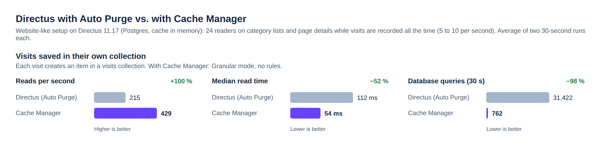
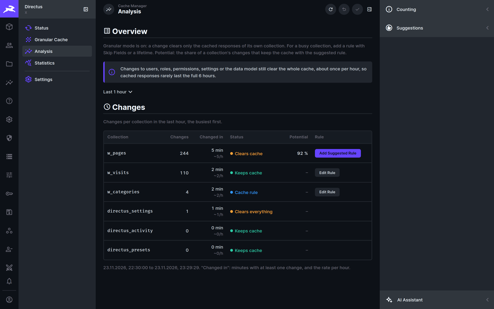
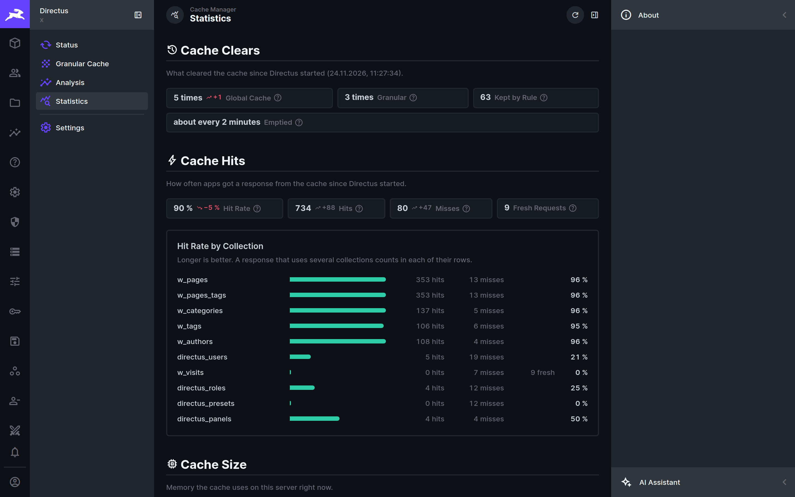
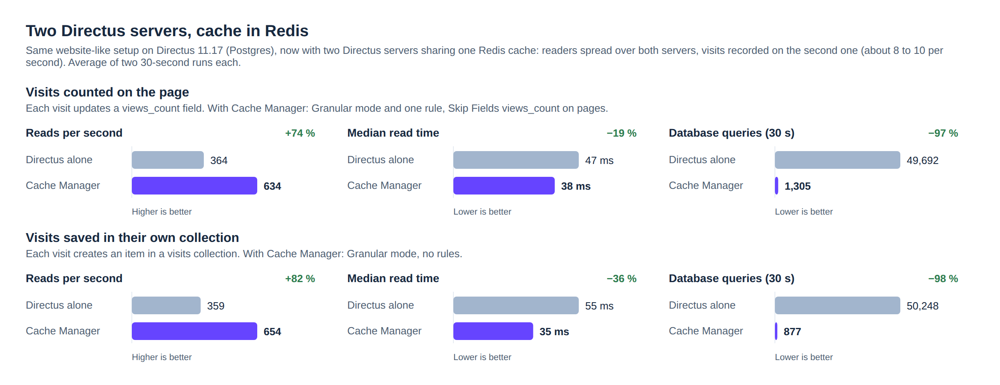

# Cache Manager

With **Auto Purge** on, Directus throws away its whole cache on every change. One busy collection, such as a visit log or a view counter, can keep the cache nearly empty. Cache Manager makes a change clear **only the cached responses that use the changed collection**, and shows what clears the cache and how often. Everything is set in the Data Studio.

<picture>
  <source media="(prefers-color-scheme: dark)" srcset="https://raw.githubusercontent.com/domdus/directus-extension-cache-manager/main/docs/benchmark-dark.png" />
  
</picture>

Measured on a website-like setup, see [Performance](#performance).

## Features

- **Granular Cache**: a change clears only the cached responses that use the changed collection, including through relations. Works for REST and GraphQL.
- **Clear single items** (advanced): a change to one item keeps the cached single-item responses of all other items.
- **Rules per collection**: choose which changes clear, ignore fields like a view counter, and set a lifetime per collection.
- **Analysis**: which collections change how often, with suggested rules.
- **Statistics**: what each change cleared, the hit rate per collection, the cache size, what a change to each collection clears, and the last 24 hours.
- **Cache settings in the Data Studio**: Auto Purge, Skip Cache and the cache lifetime, applied without a restart.
- **Several Directus servers**: with a Redis cache, all servers share what to clear and pick up saved settings.
- **Export and import** of all settings.

## Quick Start

After [installing](#installation), open **Cache Manager** from the module bar (admins only):

1. **Status**: turn on **Auto Purge** and click **Save & Apply** (✓).
2. **Granular Cache**: choose **Granular** and click **Save & Apply** (✓).

That's all. Every change now clears only the cached responses that use the changed collection. After a day, **Analysis** shows whether a busy collection still clears a lot.

## Installation

Directus 9.26 to 12.x (tested with 9.26, 10.13, 11.7, 11.17 and 12.5).

**Marketplace:** search for **Cache Manager** in **Settings → Marketplace**. The extension has API parts, which some Directus setups don't allow from the Marketplace. If it isn't listed there, install it manually.

**Manual:** run `npm install directus-extension-cache-manager`, copy `package.json` and the `dist` folder into `extensions/directus-extension-cache-manager` of your Directus, and restart Directus.

Then enable **Cache Manager** in **Settings → Project Settings → Modules**.

**Restart Directus after every install or update.** Granular mode only starts when Directus starts; until then, the page shows a notice.

## Granular Cache

- **Global**: how Directus does it. Every change clears every cached response.
- **Granular**: a change clears only the cached responses that use the changed collection. For example:
  - A new visit clears cached responses that show visits. Pages and videos stay cached.
  - A renamed service also clears the page list that shows service names.

Changes to users, roles, permissions, settings, flows or the data model still clear everything, because they can change any response. Switching to Granular clears the cache once.

### Clear single items (advanced)

With this on, a change to page 5 only clears the single-item responses of page 5, such as `/items/pages/5` or GraphQL `pages_by_id` (GraphQL works this way on newer Directus versions, tested on 11.17 and 12.5; on older ones it clears with the collection). Single-item responses of other pages stay; lists of pages still clear. It helps when a collection is read item by item and its items change often, such as stock or prices. See [Performance](#clear-single-items).

### Rules per collection

Most projects need no rules. Add one for a collection that changes very often:

| Setting | What it does | Example |
|---|---|---|
| **Create, Update, Delete** | Which changes clear. All off: changes never clear | Turn off Update where only new or deleted items matter |
| **Skip Fields** | A change that only touches these fields keeps the cache | `views_count`: counting a view keeps the cache, a new title clears it |
| **Lifetime** | How long responses that use this collection stay cached | `5m` for a collection that never clears, `1d` for pages that rarely change |

Prefer a small rule over "never clear". Never clearing `videos` because of a view counter also hides new videos until the cache expires. Skip Fields `views_count` still shows them right away.

## Analysis

Reads the Directus activity log for the last hour up to the last 7 days and lists the collections by how often they changed.

**In Granular mode**, a change only clears the responses of its own collection, so the page helps with busy collections:

- **Potential**: most changes to this collection only touch the same few fields, such as a view counter. With a rule that has these Skip Fields, this share of its changes keeps the cache.
- **Add Suggested Rule** adds that rule; **Add Rule** adds one with default settings. Both open it on **Granular Cache** for a check before saving.
- **Cache rule** in the Status column: the collection has a rule that keeps some of its changes. **Clears everything**: users, roles, permissions, settings and the data model still clear the whole cache.

**In Global mode**, every change clears the whole cache. The page shows how often that happened and suggests collections that should never clear:

- **Suggested**: collections that change at least 3 times per hour, mostly not by editors. **Apply Suggested** adds a rule that never clears for them.
- **Check impact** marks names like subscriptions, payments or access, which apps may need up to date.
- Select collections and click **Never Clear Selected**, or **Clear Again** to undo.

Collections with activity tracking turned off show **Not measured**. Changes that aren't in the activity log, such as some Flows or imports, can't be counted; the page names collections where it saw more changes than the log has since Directus started. Works with PostgreSQL and MySQL.

## Statistics

What happened since Directus started: global cache clears, granular clears, changes a rule kept, and the latest events with their reason. The numbers reset when Directus restarts.

Each number shows how it changed in the last hour, like a stock price: green is better, red is worse, grey is neither.

- **Cache Hits**: how often apps got a response from the cache. **Hit Rate** is hits ÷ (hits + misses). A miss is a response that wasn't in the cache, so Directus built and stored it. **Fresh Requests** asked for the latest data with `Cache-Control: no-store` and skip the cache; they don't count as misses. In Granular mode, **Hit Rate by Collection** shows the same per collection. With Redis, only the totals are counted.
- **Cache Size** (cache in memory): size, number of cached responses, the largest size in the last 24 hours, and expired responses deleted.
- **What a Change Clears**: per collection, the cached responses that use it, their share of the cache, and how often the collection changes. A change to the collection clears them, so shorter bars are better; a long bar with many changes per hour empties the cache often. A response that uses several collections counts in each row, so the rows add up to more than the total. **Kept**: the collection never clears.
- **Last 24 Hours**: changes per hour by result, hits and misses per hour, and with the cache in memory the cache size per hour.

## Settings on Status

| Setting | What it does | Recommended |
|---|---|---|
| **Auto Purge** | On: changes clear the cache, so everyone sees them right away. Off: changes only show once cached responses expire | On |
| **Skip Cache** | Lets an app ask for a fresh response with the header `Cache-Control: no-store` | On, unless your Directus is open to the public |
| **Cache Lifetime** | How long cached responses stay if nothing clears them, e.g. `5m`, `1h` or `1d` | 5 minutes to a few hours |
| **Ignored Collections** | Collections from the Directus configuration that never clear the cache. Shown only; use rules instead | Keep it short |

Saved settings apply right away and survive a restart. **Reset to Configured Values** goes back to your Directus configuration.

## Good to Know

- **Apps that need fresh data** right away, e.g. an access check after a purchase, can send `Cache-Control: no-store` (with **Skip Cache** on). Send it only for those requests: **Statistics** counts them as Fresh Requests per collection, so you can check.
- **Several Directus servers** need the cache in Redis. Cache Manager then keeps its list of what each response uses there too: a change on any server clears what any server cached, and saved settings reach all servers within about 10 seconds. Statistics count per server.
- **Saving clears the cache once**, because it writes to the project settings.
- **Expired responses in memory**: Directus only deletes an expired response when it is requested again. Cache Manager deletes them about once a minute, so the cache doesn't fill up with them. Not needed with Redis.
- **If a future Directus version isn't supported**, the page says so and Directus clears the whole cache as usual.
- **Responses Cache Manager can't trace**, such as GraphQL `server_info` or custom endpoints, are cleared on every change, as in Directus.
- **Earlier versions** had an Ignore List page. Its entries become rules that never clear on the first start.

## Performance

Directus 11.17 with Postgres and the cache in memory, on a website-like setup: 2,000 pages, each with a category, an author and 3 tags. 24 readers request category lists and page details (62 different requests) for 30 seconds, while 5 to 10 visits per second are saved in their own collection. Both with Auto Purge on; Cache Manager in Granular mode without rules. Average of two runs.

| | Directus | Directus + Cache Manager | Difference |
|---|---|---|---|
| Reads from the cache | under 1 % | **100 %** | |
| Reads per second | 215 | **429** | **+100 %** |
| Median read time | 112 ms | **54 ms** | **−52 %** |
| Database queries | 31,422 | **762** | **−98 %** |
| Database CPU time | 8.7 s | **0.6 s** | **−93 %** |

If visits are counted in a field on the pages (`views_count`), add a rule with Skip Fields `views_count`. The results are then the same as above.

### Two Directus servers with Redis

The same setup on two Directus servers sharing one Redis cache, with visits saved on the second one.

<picture>
  <source media="(prefers-color-scheme: dark)" srcset="https://raw.githubusercontent.com/domdus/directus-extension-cache-manager/main/docs/benchmark-redis-dark.png" />
  
</picture>

| | Directus | Directus + Cache Manager | Difference |
|---|---|---|---|
| Reads per second | 359 | **654** | **+82 %** |
| Median read time | 55 ms | **35 ms** | **−36 %** |
| Database queries | 50,248 | **877** | **−98 %** |
| Database CPU time | 12.4 s | **0.7 s** | **−94 %** |

### Clear single items

The same setup, but instead of visits, random pages get a new title. Every change hits the pages collection, so Granular alone can't keep more than Directus does. With **Clear single items**, a change only clears that page's single-item response and the page lists.

| 10 title changes per second | Directus | Granular | Granular + single items |
|---|---|---|---|
| Reads from the cache | 1 % | 4 % | **68 %** |
| Reads per second | 210 | 206 | **304 (+45 %)** |
| Database queries | 30,985 | 30,253 | **15,272 (−51 %)** |
| Database CPU time | 8.7 s | 8.3 s | **5.0 s (−43 %)** |

| 1 title change per second | Directus | Granular | Granular + single items |
|---|---|---|---|
| Reads from the cache | 84 % | 84 % | **95 %** |
| Reads per second | 377 | 380 | **402 (+7 %)** |
| Database queries | 9,324 | 9,283 | **3,459 (−63 %)** |
| Database CPU time | 2.8 s | 2.8 s | **1.4 s (−50 %)** |

At 10 changes per second, each change took a little longer (more cached responses to sort through), and the slowest 5 % of reads were about 10 % slower.

### Overhead

Reads from the cache and saves are as fast as without Cache Manager. A read that isn't cached takes about 3 ms longer in Granular mode, a little more with Redis. The gain grows with slower queries and a database on another server; these tests ran on one machine.

## Uninstall

1. **Cache Manager → Settings → Remove Extension Data**. This restores the configured values and deletes the extension's field. Export first if you may need your settings again.
2. Remove the extension and restart Directus.

If you skip step 1, delete the field `cache_manager` in **Settings → Data Model → System Collections → Settings**.

## License

MIT
