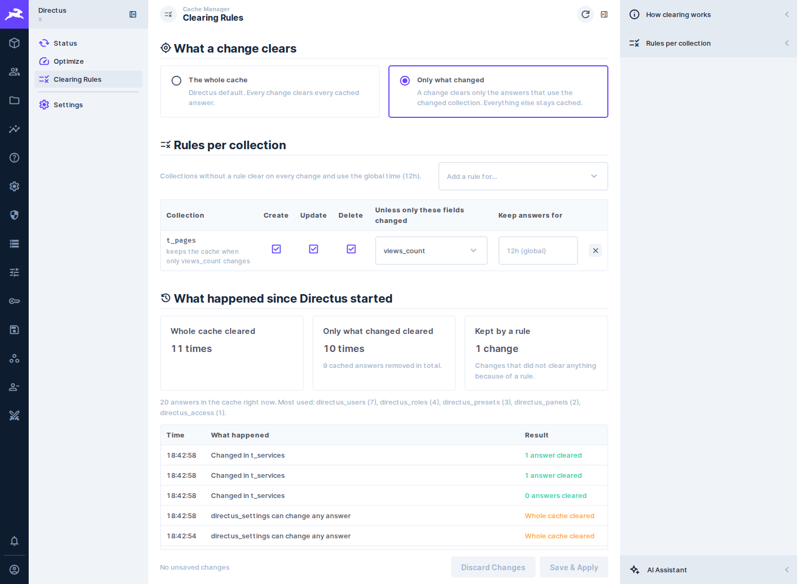

# Cache Manager

Stop Directus from throwing away its whole cache on every change. Cache Manager shows what clears the cache, lets you ignore busy collections, and can make a change clear **only the cached answers that use the changed collection**. Everything is set in the Data Studio. No config files, no restart.



Open **Cache Manager** from the module bar (admins only). **Status** shows the settings in use, two switches and how long answers stay in the cache. **Optimize** shows what clears the cache and lets you choose which collections to ignore. Changes to an ignored collection don't clear the cache. **Clearing Rules** makes a change clear only the cached answers that use the changed collection, and sets rules and cache lifetimes per collection. **Settings** checks for updates, exports and imports what you saved, and removes the extension's data before you uninstall.

## Why

Directus keeps a copy of its answers, the cache, so it does not have to ask the database every time. By default, any change to any collection clears the **whole** cache. After clearing, Directus has to load everything from the database again, which is slower.

One busy collection, such as a view counter or a statistics log, can clear the cache almost every minute. Then the cache hardly helps. Finding that collection usually means searching the activity log by hand, changing the configuration and restarting Directus. This extension does the counting for you and applies your choice at once.

Directus' only built-in way out is the ignore list (`CACHE_AUTO_PURGE_IGNORE_LIST`). It is all or nothing: an ignored collection never clears anything, so its own answers stay old until they expire, and every app that needs it up to date has to send `Cache-Control: no-store`. The list also keeps growing, and someone has to find out first which collections belong on it. **Clearing Rules** solves the actual problem instead: a counted visit only clears the cached answers that contain visits. Pages, videos and everything else stay cached.

## Installation

Supports **Directus 9.26 through 12.x**. Tested with 9.26, 10.13, 11.7, 11.17 and 12.5.

### npm

```bash
npm install directus-extension-cache-manager
```

Place the package in your Directus `extensions` folder (or install into a project that loads extensions from `node_modules`), then restart Directus.

### Manual installation

1. Install and build:

```bash
cd directus-extension-cache-manager
npm install
npm run build
```

2. Copy the built package into your Directus `extensions` folder (include `package.json` and the `dist` folder).

3. Restart Directus. At startup the extension adds a hidden JSON field `cache_manager` to `directus_settings`.

4. In the Data Studio:

   1. Open **Settings → Project Settings → Modules**
   2. Enable **Cache Manager**
   3. Open **Cache Manager** from the left bar

## Configure

1. Open **Cache Manager → Optimize** and pick a time period (last hour to last 7 days).
2. Read the first tile, **How often the cache is cleared**. Example: "12 times per hour. The cache was cleared 296 times in the last 24 hours." Lower is better.
3. Select collections in the table and click **Ignore selected** (or **Stop ignoring selected**), pick one with **Ignore another collection…**, or click **Ignore suggestion** in the **Suggestion** tile. The **Status** column shows what Save & Apply will change ("Will keep cache", "Will clear cache"). The tile **Your changes** shows the effect, for example "Ignoring your choice: 3 times per hour instead of 12".
4. Optionally change the switches or how long answers stay in the cache on **Status**. Both pages share your unsaved changes. A notice lists what is not saved yet.
5. Click **Save & Apply** at the bottom of either page. It is used right away. **Discard Changes** next to it drops what you have not saved yet. The bar also shows how many changes are not saved.

**Reset to Configured Values** on the Status page removes what you saved here and uses the configured values again.

### Settings page

- **Extension Updates**: checks npm for a newer version.
- **Export / Import**: downloads what you saved as a JSON file, or loads such a file. An import is checked like Save & Apply (for example, every collection must exist in this project) and is used right away.
- **Remove extension data**: uses the configured values again and deletes the `cache_manager` field. Use it before uninstalling.

## The settings

| In the module | Setting name | On | Off | Recommended |
|---|---|---|---|---|
| Clear the cache when content changes | `CACHE_AUTO_PURGE` | A change to a collection that is not ignored clears the whole cache. Everyone sees changes right away | Changes never clear the cache. They show up when the cached copy expires, so editors may wait that long | On |
| Allow apps to skip the cache | `CACHE_SKIP_ALLOWED` | An app can ask for fresh data with the header `Cache-Control: no-store` | The header has no effect | On, if your Directus is not open to the public |
| Ignored collections | `CACHE_AUTO_PURGE_IGNORE_LIST` | | | Collections that change very often, and that nobody needs up to date to the second: counters, logs, statistics |
| How long answers stay in the cache | `CACHE_TTL` | A duration like `5m`, `1h` or `1d`, at most 30 days | | Between 5 minutes and a few hours. Shorter means fresher data, but more work for the database. Longer means less work for the database, but data that is not cleared can be older |

A new value for **How long answers stay in the cache** applies to new entries right away. Entries already in the cache keep their old lifetime until they expire or the cache is cleared.

**Where the cache is kept** (`CACHE_STORE`) is shown on the Status page, but can't be changed here.

Ignored collections can be served from the cache for up to that time after a change. Apps can ask for fresh data with the header `Cache-Control: no-store` when **Allow apps to skip the cache** is on. The Data Studio always loads selected collections fresh, so editors see their changes.

Don't ignore collections that decide what users may see or buy, like subscriptions, purchases or access rights. Only ignore them if the apps that read them ask for fresh data. Otherwise a user could get or lose access late.

## Clearing Rules

### What it does

A cached **answer** is one API response that Directus keeps, for example `GET /items/pages?fields=title,service.name`. Normally any change clears all of them.

On **Cache Manager → Clearing Rules**, choose what a change clears:

- **The whole cache**: Directus' default.
- **Only what changed**: a change clears only the answers that use the changed collection. Examples:
  - A new item in `visits` clears answers that read `visits`. Cached pages and videos stay.
  - A renamed item in `services` also clears `GET /items/pages?fields=title,service.name`, because that answer shows the service name through a relation.
  - A save that creates related items along the way (a page with a new service inside it) clears the answers of all collections it wrote.

Changes to users, roles, policies, permissions, access, settings, flows or the data model still clear everything, because they can change any answer. So do schema changes and **Clear cache** in Directus. Turning **Only what changed** on clears the cache once.

### Rules per collection

Add a rule for a collection to change what its changes do. Rules also work with **The whole cache**.

| Setting | What it does | Example |
|---|---|---|
| **Create / Update / Delete** | Which changes clear the cache | Turn off Update for a collection where only new or deleted items matter |
| **Unless only these fields changed** | A change that only touches these fields keeps the cache. Any other field still clears | `views_count` on videos: counting a view keeps the cache, a new title clears it |
| **Keep answers for** | How long answers that use this collection stay cached, instead of `CACHE_TTL` | `5m` for a collection that is ignored, so its answers are never older than 5 minutes; `1d` for pages that change rarely |

An answer that uses several collections stays as long as the shortest time among them. Collections without their own time count with the global one.

Rules are often a better fit than the ignore list. Ignoring `videos` because of a view counter also hides new and deleted videos until the cache expires. A rule that skips only `views_count` keeps the cache for counting views and still shows a new video right away.

### What happened since Directus started

The bottom of the page counts how often the whole cache was cleared, how often only affected answers were cleared, and which changes a rule kept. The last 50 events are listed with their reason, for example "Changed in services · 3 answers cleared" or "Only views_count changed in videos · Kept (rule)". Use it to check your rules before you rely on them.

### How it works

Directus has no setting or hook for this, so the extension steps in at three places at runtime. It does not patch Directus files.

1. **When Directus stores an answer**, the extension notes which collections the answer uses: the requested collection, every collection its `fields`, `filter`, `deep` and `sort` reach through relations, and the collections that the reader's read permissions filter on. Answers it can't work out (GraphQL, flow webhooks, custom endpoints, `/server`) are noted as "uses everything" and are cleared on every change, as before.
2. **When a change is saved**, the extension notes the collection, the kind of change, the fields sent, and every related item written along the way.
3. **When Directus then clears the cache**, the extension checks the rules and deletes only the answers that use the written collections. Clears that don't come from saving items (schema, permissions, settings, a manual clear) still clear everything.

An answer that was read just before a change but is stored just after it would be out of date. Directus core has this problem too. The extension drops such an answer instead of keeping it.

### Requirements

- **One Directus process.** The list of which answer uses which collection lives in memory. With several processes (which need Redis anyway), use **The whole cache**. The page warns when the cache is kept in Redis.
- **Tested with Directus 9.26, 10.13, 11.7, 11.17 and 12.5** (Postgres, memory cache). Because it relies on how Directus works inside, a future version may change that. If the extension can't attach, the page says so and Directus clears the whole cache as usual.
- **Apps still need `Cache-Control: no-store`** for reads that must be up to date right away, for example access checks after a purchase.

## How the Optimize page counts

- A minute counts as "cleared" when at least one collection that is not ignored changed in it. Several changes in the same minute count as one.
- **How often the cache is cleared** shows how many times per hour the cache was cleared in the chosen period (several clears in the same minute count once). Lower is better.
- **Changed in** shows, per collection, the minutes with at least one change, and how many that is per hour (for example "288 min · ~12/h").
- **Status** shows "Keeps cache" for collections ignored now, "Clears cache" for the others and "Not measured" for collections without activity tracking. Unsaved changes show as "Will keep cache" or "Will clear cache".
- **Effect if ignored** shows how much less often the cache would be cleared if you also ignored that collection. A bigger drop is better.
- The numbers come from the activity log. Changes that are not logged there can't be counted, but they still clear the cache:
  - Collections with **Activity & Revision Tracking** set to "Do not track anything". They are listed at the end of the table as **Not measured**, with a **Turn on tracking** button that opens the collection in the Data Model. They are left out of all numbers and suggestions, and tile 1 names them ("Not measured: 1 collection (…). The real number can be higher.").
  - Changes made by Flows that run without activity tracking. These can't be detected.
- If Directus deletes old activity (`RETENTION_ENABLED` with `ACTIVITY_RETENTION`), a time period longer than that shows less than actually happened. The page shows a warning then.

## Suggestions

A collection is suggested for ignoring when all of these are true (limits in `src/shared/constants.ts`):

- it is not ignored yet,
- it changed at least **3 times per hour** in the chosen period,
- it is not a Directus system collection. `directus_*` collections are never suggested, except `directus_activity`, `directus_presets`, `directus_notifications` and `directus_revisions`,
- it is not mostly changed by editors in the Data Studio: at most **50 %** of its changes came from logged-in users on the public address of Directus (`PUBLIC_URL`). This check needs a full address there.

## What to know

- **Not everything can be counted.** Collections without activity tracking and some Flow changes are not in the activity log, and Directus may delete old activity. The Optimize page says when this affects the numbers.
- **Several servers.** Saving changes the settings on the server that handles the save. If Directus runs on several servers, restart the others after saving. They use the saved settings when they start. The Status page warns when the settings in use don't match.
- **Saving clears the cache once**, because it writes to the project settings.
- **Databases.** The Optimize page works with PostgreSQL and MySQL. On other databases it shows an error. The settings still work.
- **Browsers and proxies.** When **Clear the cache when content changes** is off, Directus also tells browsers and proxies how long they may keep an answer. It uses the value of **How long answers stay in the cache** for that, so a new value also applies there for new answers.
- **Schema snapshots** include the extra field `cache_manager` on `directus_settings`.

## For developers

### How it works

- Directus reads these settings on every change and every request (`CACHE_TTL` each time it stores a new cache entry). Extensions get the same settings object, so the extension changes the values there and they apply at once.
- **Configured** values are the ones Directus started with: from an `.env` file, a config file or environment variables. If Directus was started with `CONFIG_PATH`, the Status page shows that file.
- **Saved here** is stored in `directus_settings.cache_manager` as `{ autoPurge, skipAllowed, ignoreList, ttl, updatedAt, updatedBy, rules }`. `null` means "use the configured value". A value equal to the configured one is stored as `null`, so later configuration changes come through.
- These changes are lost when Directus restarts, so a hook applies the saved values again at startup (`app.before`).
- Saving goes through the settings service, so it appears in the activity log and revisions under the admin who saved.
- The Optimize page uses one grouped query on `directus_activity` (creates, updates and deletes in the chosen period, per collection and minute).
- Clearing rules (`src/api/targeted.ts`):
  - The hook wraps the write methods of `ItemsService` (`createOne`, `createMany`, `updateBatch`, `updateMany`, `upsertMany`, `deleteMany`) and keeps the collection, action and fields of each write and its nested writes in an `AsyncLocalStorage` context. Nested writes are recorded on the parent because Directus tells many of them not to clear (`autoPurgeCache: false`) and relies on the parent clearing everything.
  - It wraps `clear()` and `set()` of the shared response cache (Keyv). `clear()` inside a write applies the rules and deletes only the indexed keys of the written collections; outside a write it clears everything. Activity and revision records written during a save never cause a clear on their own.
  - A middleware after Directus' cache check (`init('middlewares.after')`) works out what the answer depends on (`src/shared/dependencies.ts`) and its lifetime, which `set()` applies (also on Directus versions that ignore `res.locals.cacheTTL`).
  - A clear counter per collection protects against storing an answer that was read before a change.

### API

All routes need an admin.

| Route | Meaning |
|---|---|
| `GET /cache-manager/state` | Configured values, values in use, saved values, `CACHE_TTL`, `CACHE_STORE`, collections |
| `GET /cache-manager/analysis?hours=24&candidate=a,b` | Numbers for the Optimize page; `candidate` adds a what-if value for that list |
| `POST /cache-manager/apply` | Body `{ "autoPurge": true, "skipAllowed": null, "ignoreList": ["view_counter"], "ttl": "1h" }`. `null` or missing = configured value. List entries must be existing collections |
| `POST /cache-manager/reset` | Remove the saved values and use the configured values |
| `POST /cache-manager/cleanup` | Use the configured values, the default clearing rules, and delete the `cache_manager` field |
| `GET /cache-manager/rules` | Clearing rules, what happened since start, collections and fields |
| `POST /cache-manager/rules` | Body `{ "targeted": true, "collections": { "com_videos": { "update": true, "skipFields": ["views_count"], "ttl": "10m" } } }`. Missing values = default (clear on create, update and delete; global lifetime) |

### Development

```bash
npm install
npm test           # unit tests
npm run typecheck
npm run build
```

## Uninstall

1. Open **Cache Manager → Settings → Remove extension data** first. This uses the configured values again and deletes the `cache_manager` field from `directus_settings`. Export before, if you might need the settings again.
2. Remove the extension and restart Directus.

If you skip step 1, delete the `cache_manager` field yourself in **Settings → Data Model → System Collections → Settings**. While the extension stays installed, every restart recreates an empty field.

## License

MIT
